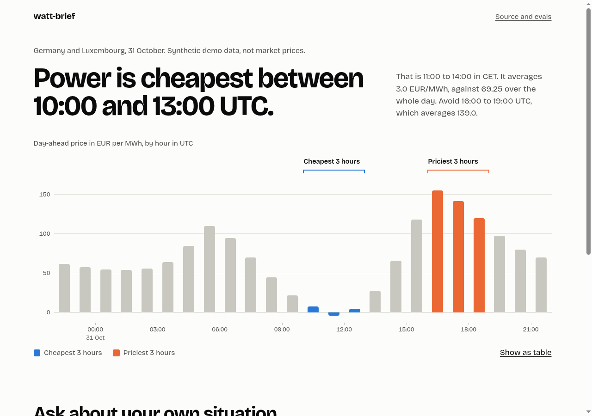
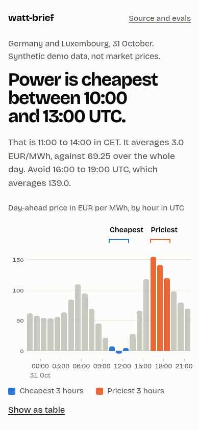
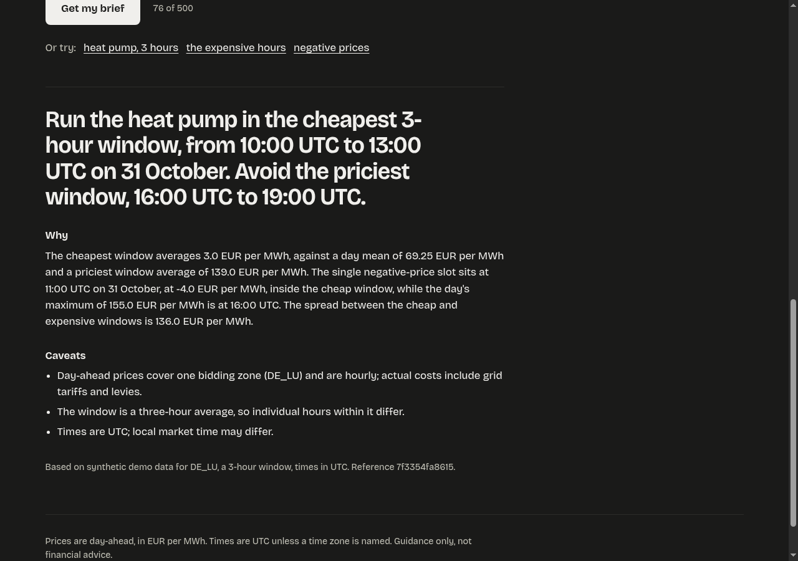

# watt-brief

Energy decisions, not energy dashboards.

Ask a question about European power prices. Get a one-page brief that ends in a
recommended decision, with the reasoning and the cost of producing it.

> Example question: *Should a flexible consumer in Germany shift load to tomorrow's
> cheapest hours?*

**Live demo: https://watt-brief.cpa-intel.tech**

**Status: working end to end on synthetic price data.** Real ENTSO-E data is waiting on an
API token. Progress and open items: [docs/status.md](docs/status.md). Every response says
which data it used.



| On a phone | A real brief, dark mode |
|---|---|
|  |  |

*Synthetic demo data. The brief is real model output. How the page was designed and why:
[docs/design.md](docs/design.md).*

## Why this exists

A model is a component. The product is a changed decision. Most AI demos stop at the
chart. This repo goes the rest of the way: agents, evals, cost tracking, a live
deployment, and a record of what broke.

It is the open companion to the series *Past the Demo* at https://cpa-intel.tech.

## How it works

```
question -> input guard -> planner -> price facts -> analyst -> output guard -> brief
              |                           |                          |
              |                  numbers come from code     rejects leaks, echoes,
        cheap, no model call                                 links and invented figures
```

- **Input guard:** length, Unicode, delimiter and topic checks before any model call.
- **Planner:** turns the question into an enum-checked plan (zone, window hours, intent).
- **Facts:** every number is computed by code from the price series, never by the model.
- **Analyst:** writes the brief from those facts. It has no tools and no secrets.
- **Output guard:** rejects a brief that leaks the prompt, echoes attacker text, contains
  markup or links, or contains a figure that is not in the facts.
- **Critic:** built and measured, off by default. See [ADR 003](docs/adr/003-planner-yes-critic-not-yet.md).

The page opens on the day's price chart, drawn from code with no model call, so it is useful
before anyone types a word. Asking a question adds a brief and moves the chart to the window
the brief talks about.

Each layer is measured on its own in [docs/eval-results.md](docs/eval-results.md), including
what it got wrong.

## Data

[ENTSO-E Transparency Platform](https://transparency.entsoe.eu/) day-ahead prices.
Public. Needs a free API token (register, then request one by email to their support).

## Models

Any OpenAI-compatible endpoint. Development runs on [DeepInfra](https://deepinfra.com/).
Model names and base URL live in config, not in code. See
[ADR 001](docs/adr/001-openai-compatible-provider.md).

## Run it

```
cp .env.example .env     # add your keys
uv sync
uv run pytest            # offline, free
uv run python -m watt_brief.serve    # http://127.0.0.1:8000
```

Keys stay in `.env` and in the server's environment. Never in the repo, never in the client.
Controls, metrics and alerts: [docs/operations.md](docs/operations.md).

Run the UI checks against the running server (needs chromium; the API is mocked, so it is free):

```
node scripts/ui_check.mjs http://127.0.0.1:8000/ /tmp/watt-brief-shots
```

Smoke test your model endpoint before anything else:

```
curl "https://api.deepinfra.com/v1/openai/chat/completions" \
  -H "Content-Type: application/json" \
  -H "Authorization: Bearer $LLM_API_KEY" \
  -d '{
      "model": "deepseek-ai/DeepSeek-V4.1-Flash-1017",
      "messages": [
        {
          "role": "user",
          "content": "Hello!"
        }
      ]
    }'
```

## Decisions

Architecture decisions are in [docs/adr/](docs/adr/). The threat model is in
[docs/threat-model.md](docs/threat-model.md).

## Licence

TBD.
